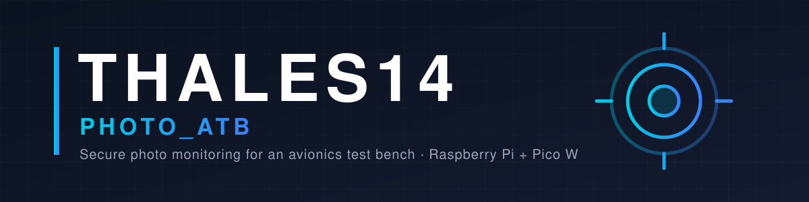
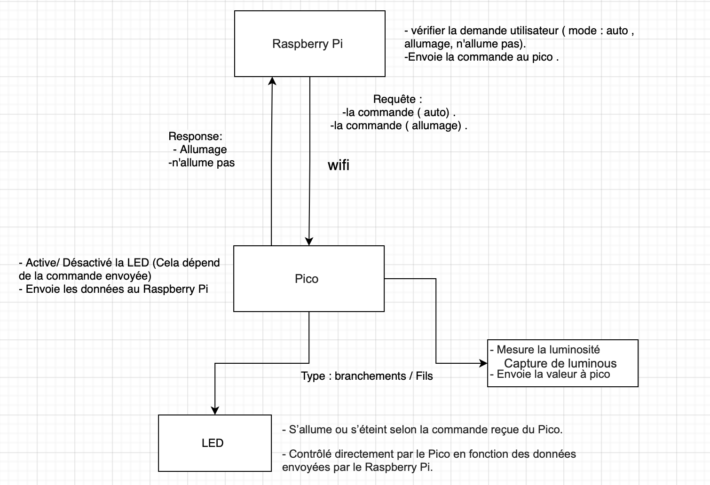
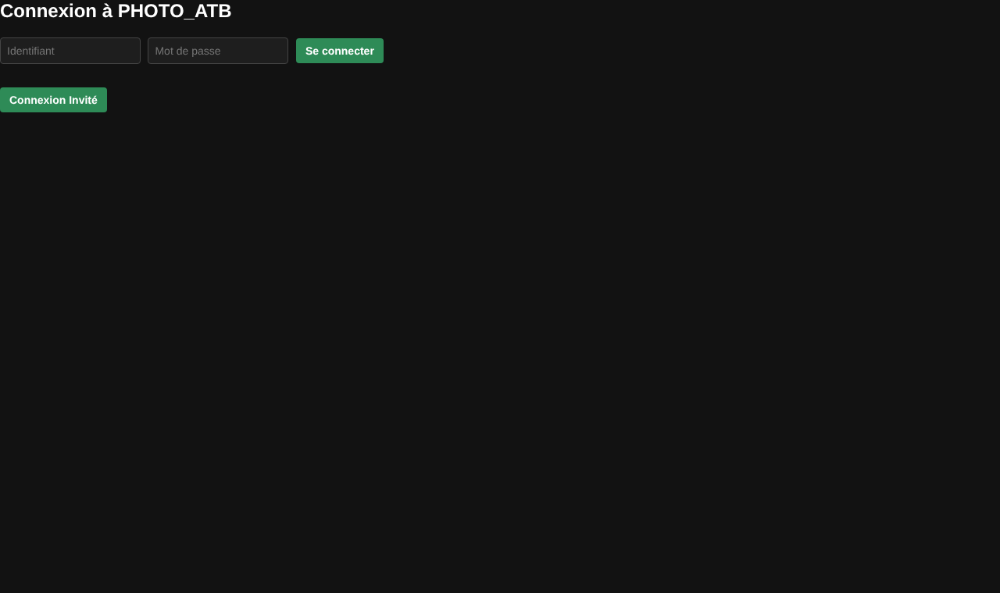
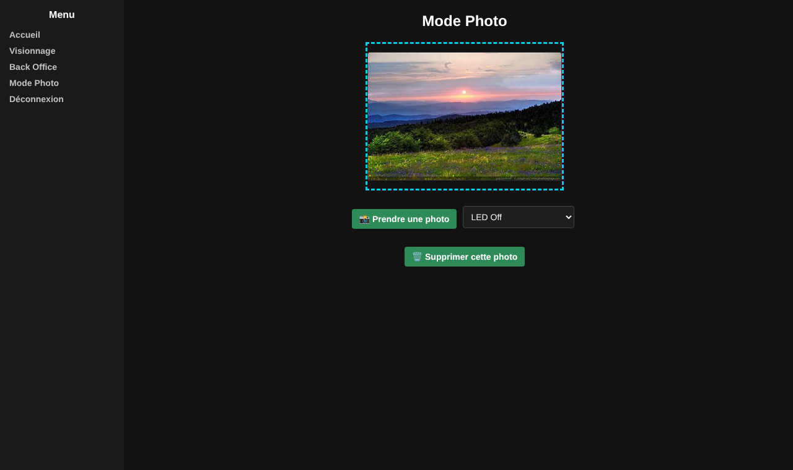
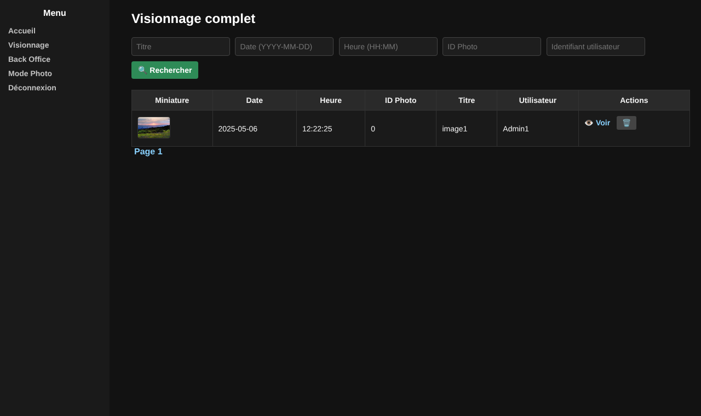
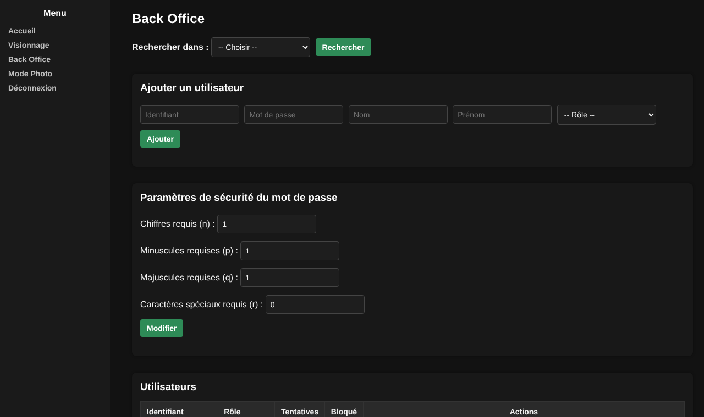

<p align="center">
  
</p>

<p align="center">
  <b>Secure, traceable photo monitoring for an avionics test bench (ATB)</b><br>
  Web interface · Raspberry Pi camera · Smart LED lighting on Raspberry Pi Pico W
</p>

<p align="center">
  
  
  
  
  
  
  
</p>

---

## 🛰️ Context

On a complex **avionics test bench**, physical changes (wiring, equipment, configuration) were not traced — which directly impacts the reliability of the tests.

**Team Thales14** designed **PHOTO_ATB**: a system that photographs the bench **manually on demand or automatically every 24 hours**, archives every picture in a structured way, and exposes everything through a **secure local web interface** with role-based access and full action logging.

> University project carried out with **Thales** — **SAÉ 15, 23 & 24**, BUT Networks & Telecommunications (Réseaux & Télécommunications), IUT Nice Côte d'Azur, 2024–2025.

## ✨ Features

| | |
|---|---|
| 📸 **Photo capture** | Manual from the web interface, or automatic every 24 h |
| 💡 **Smart lighting** | LED in 3 modes — *On*, *Off*, *Auto* (driven by a BH1750 ambient-light sensor) |
| 🔐 **Authentication** | Login / password with 4 profiles: Super Administrator, Administrator, Operator, Guest |
| 🚫 **Brute-force protection** | Account locked after 3 failed attempts (Super Administrator can never be locked) |
| 🔑 **Password policy** | bcrypt hashing + configurable rules *n / p / q / r* (digits, lowercase, uppercase, special characters), login forbidden inside the password |
| ⏱️ **Session security** | Automatic logout after 15 minutes of inactivity |
| 📜 **Audit trail** | Every action logged as *Information / Warning / Alarm* with date, user, profile and description — CSV export |
| 🗂️ **Gallery & trash** | Filters, soft delete, restore, permanent deletion |
| 🛠️ **Back-office** | User management, account unlocking, password policy settings |

## 🏗️ Architecture

```
┌──────────────┐  HTTP   ┌────────────────────────────────┐   HTTP over Wi-Fi   ┌──────────────────────┐
│   Browser    │ ──────► │          Raspberry Pi          │ ──────────────────► │  Raspberry Pi Pico W │
│ (local LAN)  │         │  Apache2 + PHP  (web app)      │  /command?mode=     │  HTTP server :5000   │
└──────────────┘         │        │ commande.json         │    on | off | auto  │   ├─ LED  (GPIO 15)  │
                         │        ▼                       │ ◄────────────────── │   └─ BH1750 (I2C)    │
                         │  app.py (Python)               │     LED status      └──────────────────────┘
                         │   ├─ USB camera (OpenCV)       │
                         │   └─ SQLite database           │
                         └────────────────────────────────┘
```

1. The user clicks **"Prendre une photo"** → the web app writes the command to `commande.json`.
2. `app.py` on the Raspberry Pi reads the command and sends the LED mode to the **Pico W** over HTTP.
3. The Pico switches the LED (in *Auto* mode, based on the measured light level: ON if ≤ 30 lux).
4. The camera captures the picture, saved to `web/assets/images/` and recorded in the database.

<p align="center">
  
</p>

## 🖥️ Screenshots

| Login | Photo mode |
|:---:|:---:|
|  |  |
| **Gallery** | **Back-office** |
|  |  |

## 📁 Project structure

```
thales14-photo-atb/
├── web/                          # PHP web application (deployed to /var/www/html)
│   ├── login.php                 # Authentication + lock after 3 failed attempts
│   ├── home.php                  # Home page + photo filters
│   ├── mode-photo.php            # Take a photo + choose LED mode
│   ├── visionnage.php            # Full gallery
│   ├── voir_photo.php            # Single photo view / download
│   ├── back-office.php           # Users, logs, trash, password policy
│   ├── session.php · config.php  # Session control, 15 min timeout, log retention
│   ├── password_verification.php # Password policy checks (n, p, q, r)
│   ├── bdd.php                   # SQLite connection (PDO)
│   ├── commande.json             # Command channel: web app → app.py
│   ├── assets/                   # CSS + photos
│   └── data/BdD_Thales14_V3.sqlite
├── raspberry/
│   └── app.py                    # Capture, LED commands to the Pico, automatic 24 h photo
├── pico/
│   ├── main.py                   # MicroPython HTTP server: LED + light sensor
│   ├── bh1750.py                 # BH1750 sensor driver
│   └── IP_pico.py                # Utility: print the Pico's IP address
├── database/
│   └── schema.sql                # Tables USER, PHOTO, LOGS, PARAM, RULE
└── docs/                         # Requirements, diagrams, algorithms, data models, mock-ups, project management
```

## ⚙️ Installation

### Hardware
- Raspberry Pi (Raspberry Pi OS) + USB camera
- Raspberry Pi Pico W + LED on **GPIO 15** + **BH1750** light sensor on I2C (**SDA = GP0**, **SCL = GP1**)

### 1. Web application (Raspberry Pi)
```bash
sudo apt install apache2 php libapache2-mod-php php-sqlite3
sudo cp -r web/* /var/www/html/
sudo chown -R www-data:www-data /var/www/html   # write access: database, photos, commande.json
```
Open `http://<raspberry-ip>/login.php`.

**Demo accounts** (change them after first login):

| Login | Password | Profile |
|---|---|---|
| `Admin1` | `Thales14@Admin` | Super Administrator |
| `Opera1` | `Thales14@Opera` | Operator |
| — | *"Connexion Invité"* button | Guest |

### 2. Pico W
1. In `pico/main.py`, replace `YOUR_WIFI_SSID` / `YOUR_WIFI_PASSWORD` with your Wi-Fi credentials.
2. Copy `main.py` and `bh1750.py` to the Pico (e.g. with Thonny) — `main.py` starts automatically at power-on.
3. Note the IP address printed in the console.

### 3. Capture script (Raspberry Pi)
```bash
pip install opencv-python requests
# Set PICO_IP at the top of raspberry/app.py to the Pico's address, then:
sudo python3 raspberry/app.py            # service mode (web commands + 24 h auto photo)
sudo python3 raspberry/app.py terminal   # take a single photo now
```

## ✅ Requirements coverage

Extract of the security requirements from the specification ([`docs/exigences-securite.docx`](docs/exigences-securite.docx)):

| Reference | Requirement | Implementation |
|---|---|---|
| Acces-100 / 110 | Login/password access, features limited by profile | `login.php`, `session.php`, role checks on every page |
| Log-200 / 210 / 220 | Event logging typed Information / Warning / Alarm with date, user, profile, action | `LOGS` table, back-office log view + CSV export |
| MdP-300 → 330 | At least *n* digits, *p* lowercase, *q* uppercase, *r* special characters | `password_verification.php` + `PARAM` table |
| MdP-340 | Password must not contain accents | `password_verification.php` |
| MdP-350 | Password must not contain the login | `password_verification.php` |
| MdP-360 | Passwords stored encrypted | `password_hash()` (bcrypt) |
| MdP-370 | Lock after 3 failed attempts | `login.php` |
| MdP-380 / Admin-440 | *n, p, q, r* configurable by administrators | `back-office.php` |
| Admin-400 → 430 | Administrators add/delete Operators and Administrators and set their passwords | `back-office.php` |
| Admin-450 | Administrators change the password of a locked account | `back-office.php` |
| SuperAdmin-500 / 510 / 520 | Single Super Administrator, never locked, same rights as an Administrator | `login.php`, `back-office.php` |
| SiteWeb-640 | Logs kept for a configurable maximum period (6 months by default) | `LOG_RETENTION_MONTHS` in `config.php`, purge in `bdd.php` |

## 🐛 Fixes applied to the delivered code

The code is the version delivered for the final evaluation; only the following fixes were applied:

**Bugs**

- **`back-office.php`** required `password_verification.php`, but the file was still named `verifier_mot_de_passe.php` → fatal error; file renamed.
- **Password policy** — operator precedence bug (`!preg_match_all(...) >= $n`) made the digit/lowercase/uppercase/special-character checks ineffective; replaced by `preg_match_all(...) < $n`.
- **Permanent photo deletion** used a file path coming from the form (path traversal risk); the path is now read from the database.
- **`back-office.php`** now uses `session.php`, so the 15-minute inactivity timeout also applies there.
- `style.css` placed in `assets/css/`, the path used by every page.

**Requirements completed**
- **MdP-340** — passwords containing accents are now rejected.
- **Admin-420 / 430** — Administrators can now add, edit and delete other Administrators (previously reserved to the Super Administrator). The Super Administrator remains protected.
- **SiteWeb-640** — logs older than `LOG_RETENTION_MONTHS` (6 by default, in `config.php`) are purged automatically.
- **Log-210** — user modifications were logged with an undefined type (`Action admin`); they now use `Information`.

**Publication**
- Demo database cleaned (test accounts and logs removed) and Wi-Fi credentials replaced with placeholders.


### My contribution — Mohammed Al-Abri
- Designed the system **algorithms** (Raspberry Pi logic and lighting control) — see [`docs/architecture/`](docs/architecture/)
- Designed the **communication protocol** between the Raspberry Pi and the Pico W
- Developed **`raspberry/app.py`**: manual capture from the web app, automatic capture every 24 h, LED commands sent to the Pico, database recording
- **Fully configured the Raspberry Pi** to host the web application locally (Apache2 + PHP + SQLite)
- **End-to-end integration** web app ↔ Raspberry Pi ↔ Pico, hardware/software testing and troubleshooting (file permissions, SQLite database, camera detection)

## 📚 Documentation

- 📄 [Security requirements (specification)](docs/exigences-securite.docx)
- 🎤 [Final presentation](docs/presentation-soutenance.pdf)
- 🧭 Architecture: [global communication diagram](docs/architecture/schema-communication-global.png) · [Raspberry Pi algorithm](docs/architecture/algorithme-raspberry-pi.jpg) · [lighting algorithm](docs/architecture/algorithme-led.jpg)
- 🗄️ Database: [conceptual model (MCD)](docs/base-de-donnees/mcd-entite-association.pdf) · [logical model (MLD)](docs/base-de-donnees/mld-schema-logique.pdf) · [`schema.sql`](database/schema.sql)
- 🎨 [Website mock-ups](docs/maquettes/)
- 📊 Project management: [Gantt](docs/gestion-projet/gantt-semestre-2.png) · [RACI](docs/gestion-projet/raci.png) · [anomaly report](docs/gestion-projet/fiche-anomalie.png)

